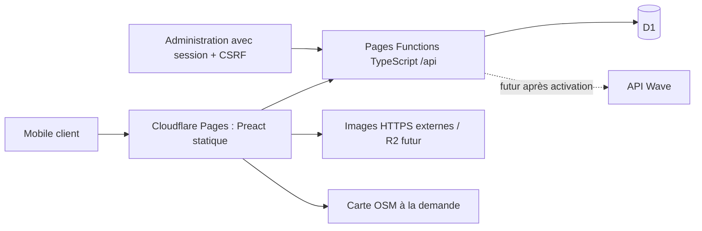
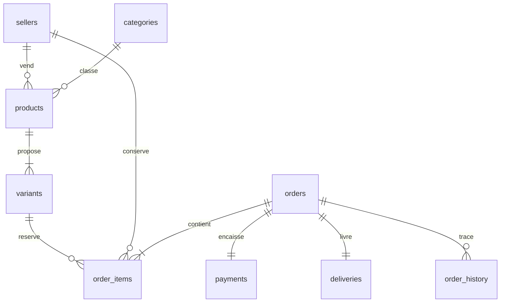

# Architecture et flux

## Schéma

Les promotions sont stockées directement sur le produit (prix, début, fin) pour cette première version. Les prix affichés sont calculés au moment de la lecture, ceux facturés au moment de la commande. Le trigger final vérifie encore le prix dans la transaction. L’expiration n’est pas une simple animation qui recommence chaque jour.

Le serveur valide puis lit le catalogue, calcule la livraison, compare le montant accepté par le client, et écrit commande, lignes, paiement et livraison dans un batch D1 atomique. Les triggers réservent le stock et rejettent toute incohérence. Les références aux vendeurs sont copiées dans les lignes pour préparer l’évolution marketplace.

Pas de compte client au lancement. Une capacité secrète autorise le suivi minimal. Le vendeur voit les données de livraison via l’administration protégée. Le seul état de paiement utilisé aujourd’hui est manuel : aucune page de retour n’affirme un succès bancaire.

Le déploiement ne nécessite ni R2, ni KV, ni service de routage géographique, ni email payant. Les compteurs anti-spam sont atomiques dans D1 ; cette protection basique n’arrête pas une attaque distribuée à grande échelle. Le catalogue est paginé ; la recherche est bornée pour respecter les limites de motifs LIKE de D1.
